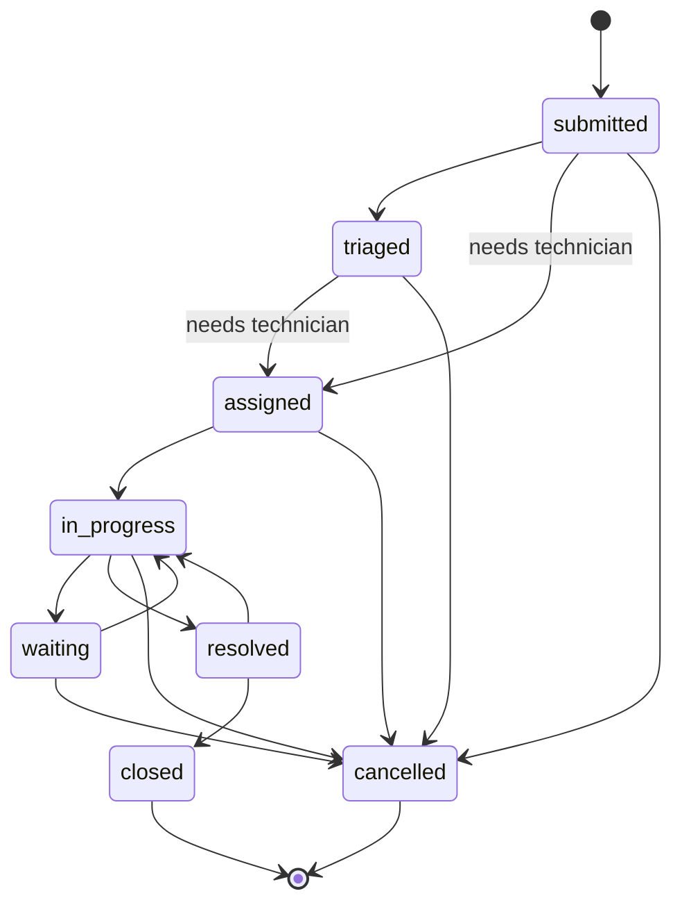

# API reference

> Generated by `python -m scripts.api_docs` from the code. Do not edit by hand.
> Interactive docs (non-production): `/docs`. Authentication is delegated to Clerk (`Authorization: Bearer <session JWT>`); see the README.

## Endpoints

### administration

| Method | Path | Summary | Access |
| --- | --- | --- | --- |
| GET | `/admin/permissions` | List permissions | `configuracion:ver` |
| GET | `/admin/roles` | List roles | `usuarios:ver` |
| POST | `/admin/roles` | Create a custom role | `usuarios:asignar` |
| GET | `/admin/roles/manage` | Roles with their hierarchy, grants and inherited permissions | `usuarios:asignar` |
| GET | `/admin/roles/matrix` | Role-permission matrix | `configuracion:ver` |
| DELETE | `/admin/roles/{role_id}` | Delete a custom role | `usuarios:asignar` |
| PATCH | `/admin/roles/{role_id}` | Rename, re-parent, activate or deactivate a role | `usuarios:asignar` |
| PUT | `/admin/roles/{role_id}/permissions` | Replace the permissions a role grants itself | `usuarios:asignar` |
| GET | `/admin/users/pending` | List pending users | `usuarios:ver` |
| DELETE | `/admin/users/{user_id}/roles/{role_id}` | Revoke a role from a user | `usuarios:asignar` |

### attachments

| Method | Path | Summary | Access |
| --- | --- | --- | --- |
| DELETE | `/attachments/{attachment_id}` | Delete an attachment | any signed-in user |
| GET | `/attachments/{attachment_id}/download` | Download an attachment | any signed-in user |
| GET | `/equipment/{equipment_id}/attachments` | List an equipment item's attachments | `equipos:ver` |
| POST | `/equipment/{equipment_id}/attachments` | Attach a file to equipment | `equipos:adjuntar` |
| GET | `/maintenance/requests/{request_id}/attachments` | List a ticket's attachments | `tickets:ver` |
| POST | `/maintenance/requests/{request_id}/attachments` | Attach a file to a ticket | `tickets:adjuntar` |

### audit

| Method | Path | Summary | Access |
| --- | --- | --- | --- |
| GET | `/audit-logs` | Query the audit trail | `auditoria:ver` |

### authentication

| Method | Path | Summary | Access |
| --- | --- | --- | --- |
| GET | `/auth/me` | Me | any signed-in user |

### dashboard

| Method | Path | Summary | Access |
| --- | --- | --- | --- |
| GET | `/dashboard/alerts` | What needs attention now | `dashboard:ver` |
| GET | `/dashboard/kpis` | Headline KPIs with period-over-period comparison | `dashboard:ver` |
| GET | `/dashboard/resolution-times` | Mean and median resolution time | `dashboard:ver` |
| GET | `/dashboard/summary` | Operational summary | `dashboard:ver` |
| GET | `/dashboard/technicians` | Technician performance for the period | `dashboard:ver` |
| GET | `/dashboard/top-failing-equipment` | Equipment with the most tickets | `dashboard:ver_todos` |
| GET | `/dashboard/trends` | Time series behind the KPI sparklines | `dashboard:ver` |
| GET | `/dashboard/workload` | Workload per technician | `dashboard:ver` |

### data-exchange

| Method | Path | Summary | Access |
| --- | --- | --- | --- |
| POST | `/imports/equipment` | Bulk-import equipment from CSV or Excel | `equipos:importar` |

### equipment

| Method | Path | Summary | Access |
| --- | --- | --- | --- |
| GET | `/equipment` | List equipment | `equipos:ver` |
| POST | `/equipment` | Create equipment | `equipos:crear` |
| GET | `/equipment/custodian-candidates` | Search users who can hold equipment | `equipos:asignar` |
| GET | `/equipment/summary` | Equipment counts by status | `equipos:ver` |
| GET | `/equipment/types` | List equipment types | `equipos:ver` |
| GET | `/equipment/{equipment_id}` | Get equipment | `equipos:ver` |
| PATCH | `/equipment/{equipment_id}` | Update equipment | `equipos:editar` |
| POST | `/equipment/{equipment_id}/custody` | Assign equipment custody | `equipos:asignar` |
| POST | `/equipment/{equipment_id}/location` | Assign equipment location | `equipos:editar` |
| GET | `/locations` | List locations | `equipos:ver` |
| POST | `/locations` | Create location | `equipos:crear` |

### inventory

| Method | Path | Summary | Access |
| --- | --- | --- | --- |
| POST | `/inventory/import` | Bulk-import stock items from CSV or Excel | `inventario:importar` |
| GET | `/inventory/import/template` | Excel template for the import | `inventario:importar` |
| GET | `/inventory/items` | List stock items | `inventario:ver` |
| POST | `/inventory/items` | Create a stock item | `inventario:crear` |
| DELETE | `/inventory/items/{item_id}` | Delete a stock item | `inventario:eliminar` |
| GET | `/inventory/items/{item_id}` | Get a stock item | `inventario:ver` |
| PATCH | `/inventory/items/{item_id}` | Update a stock item | `inventario:editar` |
| GET | `/inventory/items/{item_id}/movements` | Movement history of an item, newest first | `inventario:ver` |
| POST | `/inventory/items/{item_id}/movements` | Register a stock movement | `inventario:consumir` |
| GET | `/inventory/options` | Values of the item drop-downs | `inventario:ver` |
| POST | `/inventory/options` | Add a value to an item drop-down | `inventario:crear` |
| GET | `/inventory/overview` | Inventory metrics for the period | `inventario:ver` |

### maintenance

| Method | Path | Summary | Access |
| --- | --- | --- | --- |
| GET | `/maintenance/calendar` | Preventive services in a date range | `mantenimiento:ver` |
| GET | `/maintenance/categories` | Active request categories | `tickets:ver` |
| GET | `/maintenance/overview` | Maintenance metrics for the period | `mantenimiento:ver` |
| GET | `/maintenance/queue/summary` | Pending-requests queue metrics | `solicitudes:ver_todos` |
| GET | `/maintenance/requests` | List maintenance tickets | `tickets:ver` |
| POST | `/maintenance/requests` | Create maintenance request | `solicitudes:crear` |
| GET | `/maintenance/requests/workflow` | Ticket statuses and the moves between them | `tickets:ver` |
| GET | `/maintenance/requests/{request_id}` | Get maintenance request | `tickets:ver` |
| DELETE | `/maintenance/requests/{request_id}/assignment` | Unassign technician | `tickets:asignar` |
| POST | `/maintenance/requests/{request_id}/assignment` | Assign technician | `tickets:asignar` |
| POST | `/maintenance/requests/{request_id}/classify` | Classify (triage) a request | `solicitudes:editar` |
| GET | `/maintenance/requests/{request_id}/records` | List maintenance records | `tickets:ver` |
| POST | `/maintenance/requests/{request_id}/records` | Add maintenance record | `tickets:editar` |
| POST | `/maintenance/requests/{request_id}/reject` | Reject a request that has not started | `solicitudes:aprobar` |
| POST | `/maintenance/requests/{request_id}/status` | Transition maintenance request status | `tickets:cambiar_estado` |

### notifications

| Method | Path | Summary | Access |
| --- | --- | --- | --- |
| GET | `/notifications` | List notifications | any signed-in user |
| POST | `/notifications/read-all` | Mark all notifications read | any signed-in user |
| POST | `/notifications/{notification_id}/read` | Mark notification read | any signed-in user |

### priorities

| Method | Path | Summary | Access |
| --- | --- | --- | --- |
| GET | `/priorities` | List ticket priorities | `tickets:ver` |
| POST | `/priorities` | Create a priority | `configuracion:editar` |
| PATCH | `/priorities/{priority_id}` | Update a priority | `configuracion:editar` |

### profile

| Method | Path | Summary | Access |
| --- | --- | --- | --- |
| GET | `/profile` | My profile | `perfil:ver` |
| PATCH | `/profile` | Edit my personal data | `perfil:editar` |
| DELETE | `/profile/avatar` | Remove my photo | `perfil:editar` |
| GET | `/profile/avatar` | My photo | `perfil:ver` |
| PUT | `/profile/avatar` | Upload my photo | `perfil:editar` |
| GET | `/profile/history` | My history | `perfil:ver` |
| POST | `/profile/password` | Change my password | `perfil:editar` |

### reports

| Method | Path | Summary | Access |
| --- | --- | --- | --- |
| GET | `/reports/catalog` | Report gallery | `reportes:ver` |
| GET | `/reports/equipment` | Export the equipment inventory | `reportes:exportar` |
| POST | `/reports/generate` | Generate and download a report | `reportes:exportar` |
| GET | `/reports/history` | Recent exports, newest first | `reportes:ver` |
| GET | `/reports/overview` | Report activity for the period | `reportes:ver` |
| POST | `/reports/preview` | Preview a report with its filters | `reportes:ver` |
| GET | `/reports/summary` | Export the operational summary | `reportes:exportar` |
| GET | `/reports/tickets` | Export maintenance tickets | `reportes:exportar` |
| POST | `/reports/{report}/export` | Export a report as PDF or Excel | `reportes:exportar` |
| POST | `/reports/{report}/export/count` | How many records an export would contain | `reportes:exportar` |
| GET | `/reports/{report}/export/options` | What a report export offers | `reportes:exportar` |

### schedules

| Method | Path | Summary | Access |
| --- | --- | --- | --- |
| GET | `/maintenance/schedules` | List preventive-maintenance plans | `mantenimiento:ver` |
| POST | `/maintenance/schedules` | Create a preventive-maintenance plan | `mantenimiento:crear` |
| POST | `/maintenance/schedules/run-reminders` | Run the reminder job now | `mantenimiento:editar` |
| GET | `/maintenance/schedules/{schedule_id}` | Get a plan | `mantenimiento:ver` |
| PATCH | `/maintenance/schedules/{schedule_id}` | Update a plan | `mantenimiento:editar` |
| POST | `/maintenance/schedules/{schedule_id}/complete` | Mark the service as done | `mantenimiento:editar` |
| GET | `/maintenance/schedules/{schedule_id}/history` | Completions and reschedules of a plan | `mantenimiento:ver` |

### settings

| Method | Path | Summary | Access |
| --- | --- | --- | --- |
| GET | `/settings/categories` | Request categories, with how many requests use each | `configuracion:ver` |
| POST | `/settings/categories` | Create a request category | `configuracion:editar` |
| DELETE | `/settings/categories/{category_id}` | Delete an unused category | `configuracion:editar` |
| PATCH | `/settings/categories/{category_id}` | Rename or (de)activate a category | `configuracion:editar` |
| GET | `/settings/health` | System health | `configuracion:ver` |
| GET | `/settings/organization` | Company shown in report headers | `configuracion:ver` |
| PUT | `/settings/organization` | Set the company shown in report headers | `configuracion:editar` |

### system

| Method | Path | Summary | Access |
| --- | --- | --- | --- |
| GET | `/health` | Liveness check | public |

### technicians

| Method | Path | Summary | Access |
| --- | --- | --- | --- |
| GET | `/technicians` | List technicians | `tecnicos:ver` |
| POST | `/technicians` | Create technician | `tecnicos:crear` |
| PATCH | `/technicians/{technician_id}` | Update technician | `tecnicos:editar` |

### users

| Method | Path | Summary | Access |
| --- | --- | --- | --- |
| GET | `/admin/users` | List users | `usuarios:ver` |
| POST | `/admin/users` | Pre-register a user | `usuarios:crear` |
| GET | `/admin/users/summary` | Indicators of the Users screen | `usuarios:ver` |
| GET | `/admin/users/{user_id}` | Get a user | `usuarios:ver` |
| PATCH | `/admin/users/{user_id}` | Edit a user | `usuarios:editar` |
| POST | `/admin/users/{user_id}/activate` | Reactivate a user | `usuarios:cambiar_estado` |
| POST | `/admin/users/{user_id}/deactivate` | Deactivate a user | `usuarios:cambiar_estado` |
| POST | `/admin/users/{user_id}/password` | Set a new password for a user | `usuarios:editar` |
| POST | `/admin/users/{user_id}/roles` | Assign roles | `usuarios:asignar` |
| PUT | `/admin/users/{user_id}/roles` | Set the roles of a user | `usuarios:asignar` |

Total: **117** endpoints.

Listings accept `page`, `size`, `sort` (`field` / `-field`) and `search` and report the page in the `X-Total-Count`, `X-Page`, `X-Page-Size` and `X-Total-Pages` headers. Errors always use `{detail, code, errors, request_id}`.

## Role-permission matrix

| Permission | ADMIN | SUPERVISOR | TECHNICIAN | EMPLOYEE | AUDITOR |
| --- | --- | --- | --- | --- | --- |
| `dashboard:ver` | yes | yes | yes | yes | yes |
| `dashboard:ver_todos` | yes | yes | - | - | yes |
| `equipos:ver` | yes | yes | yes | yes | - |
| `equipos:crear` | yes | yes | - | - | - |
| `equipos:editar` | yes | yes | - | - | - |
| `equipos:asignar` | yes | yes | - | - | - |
| `equipos:adjuntar` | yes | yes | - | - | - |
| `equipos:exportar` | yes | yes | - | - | - |
| `equipos:importar` | yes | - | - | - | - |
| `solicitudes:ver` | yes | yes | yes | yes | - |
| `solicitudes:ver_todos` | yes | yes | - | - | - |
| `solicitudes:crear` | yes | yes | yes | yes | - |
| `solicitudes:editar` | yes | yes | - | - | - |
| `solicitudes:aprobar` | yes | yes | - | - | - |
| `tickets:ver` | yes | yes | yes | yes | - |
| `tickets:ver_asignados` | yes | yes | yes | - | - |
| `tickets:ver_todos` | yes | yes | - | - | - |
| `tickets:editar` | yes | yes | yes | - | - |
| `tickets:asignar` | yes | yes | - | - | - |
| `tickets:cambiar_estado` | yes | yes | yes | - | - |
| `tickets:adjuntar` | yes | yes | yes | yes | - |
| `tickets:exportar` | yes | yes | - | - | - |
| `tecnicos:ver` | yes | yes | - | - | - |
| `tecnicos:crear` | yes | yes | - | - | - |
| `tecnicos:editar` | yes | yes | - | - | - |
| `tecnicos:exportar` | yes | yes | - | - | - |
| `mantenimiento:ver` | yes | yes | yes | - | - |
| `mantenimiento:crear` | yes | yes | - | - | - |
| `mantenimiento:editar` | yes | yes | - | - | - |
| `inventario:ver` | yes | yes | yes | - | - |
| `inventario:crear` | yes | yes | - | - | - |
| `inventario:editar` | yes | yes | - | - | - |
| `inventario:eliminar` | yes | - | - | - | - |
| `inventario:consumir` | yes | yes | yes | - | - |
| `inventario:importar` | yes | - | - | - | - |
| `inventario:exportar` | yes | yes | - | - | - |
| `reportes:ver` | yes | yes | - | - | yes |
| `reportes:exportar` | yes | yes | - | - | yes |
| `usuarios:ver` | yes | - | - | - | - |
| `usuarios:crear` | yes | - | - | - | - |
| `usuarios:editar` | yes | - | - | - | - |
| `usuarios:cambiar_estado` | yes | - | - | - | - |
| `usuarios:asignar` | yes | - | - | - | - |
| `perfil:ver` | yes | yes | yes | yes | yes |
| `perfil:editar` | yes | yes | yes | yes | yes |
| `configuracion:ver` | yes | - | - | - | - |
| `configuracion:editar` | yes | - | - | - | - |
| `auditoria:ver` | yes | - | - | - | yes |

Roles inherit: EMPLOYEE → TECHNICIAN → SUPERVISOR → ADMIN (AUDITOR stands alone). Data scope follows `ver` (own), `ver_asignados` (assigned to the person) and `ver_todos` (everything).

## Ticket state diagram

| State | Can move to | On entry | Notifies requester |
| --- | --- | --- | --- |
| `submitted` | `triaged`, `assigned`, `cancelled` | - | no |
| `triaged` | `assigned`, `cancelled` | - | no |
| `assigned` | `in_progress`, `cancelled` | requires an active technician assignment | no |
| `in_progress` | `waiting`, `resolved`, `cancelled` | - | no |
| `waiting` | `in_progress`, `cancelled` | - | no |
| `resolved` | `in_progress`, `closed` | sets `resolved_at` and the resolution summary | yes |
| `closed` | - (terminal) | sets `closed_at` | yes |
| `cancelled` | - (terminal) | - | no |

Assigning a technician moves `submitted`/`triaged` tickets to `assigned` through the same guarded transition; reassigning later keeps the current state.
