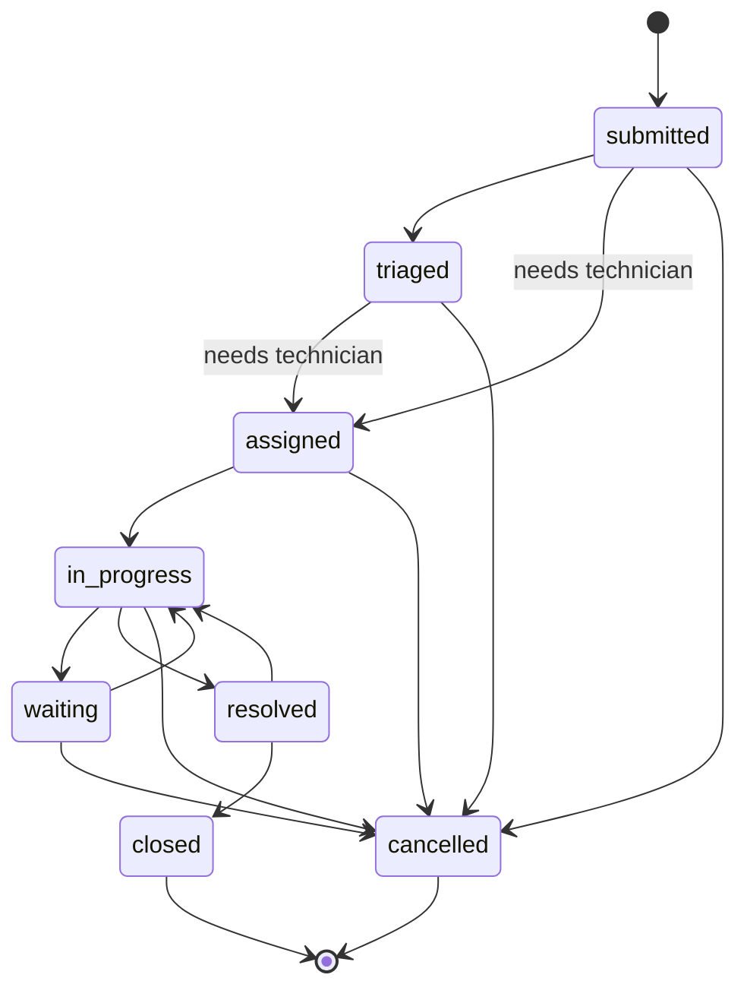

# API reference

> Generated by `python -m scripts.api_docs` from the code. Do not edit by hand.
> Interactive docs (non-production): `/docs`. Authentication is delegated to Clerk (`Authorization: Bearer <session JWT>`); see the README.

## Endpoints

### administration

| Method | Path | Summary | Access |
| --- | --- | --- | --- |
| GET | `/admin/permissions` | List permissions | `users.manage` |
| GET | `/admin/roles` | List roles | `users.manage` |
| GET | `/admin/roles/matrix` | Role-permission matrix | `users.manage` |
| GET | `/admin/users/pending` | List pending users | `users.manage` |
| POST | `/admin/users/{user_id}/roles` | Assign roles | `users.manage` |
| DELETE | `/admin/users/{user_id}/roles/{role_id}` | Revoke a role from a user | `users.manage` |

### attachments

| Method | Path | Summary | Access |
| --- | --- | --- | --- |
| DELETE | `/attachments/{attachment_id}` | Delete an attachment | any signed-in user |
| GET | `/attachments/{attachment_id}/download` | Download an attachment | any signed-in user |
| GET | `/equipment/{equipment_id}/attachments` | List an equipment item's attachments | `equipment.read` |
| POST | `/equipment/{equipment_id}/attachments` | Attach a file to equipment | `attachments.write` |
| GET | `/maintenance/requests/{request_id}/attachments` | List a ticket's attachments | `maintenance.read` |
| POST | `/maintenance/requests/{request_id}/attachments` | Attach a file to a ticket | `attachments.write` |

### audit

| Method | Path | Summary | Access |
| --- | --- | --- | --- |
| GET | `/audit-logs` | Query the audit trail | `audit.read` |

### authentication

| Method | Path | Summary | Access |
| --- | --- | --- | --- |
| GET | `/auth/me` | Me | public |

### dashboard

| Method | Path | Summary | Access |
| --- | --- | --- | --- |
| GET | `/dashboard/alerts` | What needs attention now | `dashboard.read` |
| GET | `/dashboard/kpis` | Headline KPIs with period-over-period comparison | `dashboard.read` |
| GET | `/dashboard/resolution-times` | Mean and median resolution time | `dashboard.read` |
| GET | `/dashboard/summary` | Operational summary | `dashboard.read` |
| GET | `/dashboard/technicians` | Technician performance for the period | `dashboard.read` |
| GET | `/dashboard/top-failing-equipment` | Equipment with the most tickets | `dashboard.read` |
| GET | `/dashboard/trends` | Time series behind the KPI sparklines | `dashboard.read` |
| GET | `/dashboard/workload` | Workload per technician | `dashboard.read` |

### data-exchange

| Method | Path | Summary | Access |
| --- | --- | --- | --- |
| POST | `/imports/equipment` | Bulk-import equipment from CSV or Excel | `equipment.manage` |

### equipment

| Method | Path | Summary | Access |
| --- | --- | --- | --- |
| GET | `/equipment` | List equipment | `equipment.read` |
| POST | `/equipment` | Create equipment | `equipment.manage` |
| GET | `/equipment/custodian-candidates` | Search users who can hold equipment | `equipment.manage` |
| GET | `/equipment/summary` | Equipment counts by status | `equipment.read` |
| GET | `/equipment/types` | List equipment types | `equipment.read` |
| GET | `/equipment/{equipment_id}` | Get equipment | `equipment.read` |
| PATCH | `/equipment/{equipment_id}` | Update equipment | `equipment.manage` |
| POST | `/equipment/{equipment_id}/custody` | Assign equipment custody | `equipment.manage` |
| POST | `/equipment/{equipment_id}/location` | Assign equipment location | `equipment.manage` |
| GET | `/locations` | List locations | `equipment.read` |
| POST | `/locations` | Create location | `equipment.manage` |

### inventory

| Method | Path | Summary | Access |
| --- | --- | --- | --- |
| POST | `/inventory/import` | Bulk-import stock items from CSV or Excel | `inventory.manage` |
| GET | `/inventory/items` | List stock items | `inventory.read` |
| POST | `/inventory/items` | Create a stock item | `inventory.manage` |
| DELETE | `/inventory/items/{item_id}` | Delete a stock item | `inventory.manage` |
| GET | `/inventory/items/{item_id}` | Get a stock item | `inventory.read` |
| PATCH | `/inventory/items/{item_id}` | Update a stock item | `inventory.manage` |
| GET | `/inventory/items/{item_id}/movements` | Movement history of an item, newest first | `inventory.read` |
| POST | `/inventory/items/{item_id}/movements` | Register a stock movement | `inventory.consume` |
| GET | `/inventory/overview` | Inventory metrics for the period | `inventory.read` |

### maintenance

| Method | Path | Summary | Access |
| --- | --- | --- | --- |
| GET | `/maintenance/calendar` | Preventive services in a date range | `maintenance.read` |
| GET | `/maintenance/categories` | Active request categories | `maintenance.read` |
| GET | `/maintenance/overview` | Maintenance metrics for the period | `maintenance.read` |
| GET | `/maintenance/queue/summary` | Pending-requests queue metrics | role `ADMIN`, `SUPERVISOR` |
| GET | `/maintenance/requests` | List maintenance tickets | `maintenance.read` |
| POST | `/maintenance/requests` | Create maintenance request | `maintenance.create` |
| GET | `/maintenance/requests/{request_id}` | Get maintenance request | `maintenance.read` |
| DELETE | `/maintenance/requests/{request_id}/assignment` | Unassign technician | `maintenance.manage` |
| POST | `/maintenance/requests/{request_id}/assignment` | Assign technician | `maintenance.manage` |
| GET | `/maintenance/requests/{request_id}/records` | List maintenance records | `maintenance.read` |
| POST | `/maintenance/requests/{request_id}/records` | Add maintenance record | `maintenance.manage` |
| POST | `/maintenance/requests/{request_id}/reject` | Reject a request that has not started | `maintenance.manage` |
| POST | `/maintenance/requests/{request_id}/status` | Transition maintenance request status | `maintenance.manage` |

### notifications

| Method | Path | Summary | Access |
| --- | --- | --- | --- |
| GET | `/notifications` | List notifications | public |
| POST | `/notifications/read-all` | Mark all notifications read | public |
| POST | `/notifications/{notification_id}/read` | Mark notification read | public |

### priorities

| Method | Path | Summary | Access |
| --- | --- | --- | --- |
| GET | `/priorities` | List ticket priorities | `maintenance.read` |
| POST | `/priorities` | Create a priority | `priorities.manage` |
| PATCH | `/priorities/{priority_id}` | Update a priority | `priorities.manage` |

### reports

| Method | Path | Summary | Access |
| --- | --- | --- | --- |
| GET | `/reports/catalog` | Report gallery | `reports.read` |
| GET | `/reports/equipment` | Export the equipment inventory | `reports.read` |
| POST | `/reports/generate` | Generate and download a report | `reports.read` |
| GET | `/reports/history` | Recent exports, newest first | `reports.read` |
| GET | `/reports/overview` | Report activity for the period | `reports.read` |
| POST | `/reports/preview` | Preview a report with its filters | `reports.read` |
| GET | `/reports/summary` | Export the operational summary | `reports.read` |
| GET | `/reports/tickets` | Export maintenance tickets | `reports.read` |

### schedules

| Method | Path | Summary | Access |
| --- | --- | --- | --- |
| GET | `/maintenance/schedules` | List preventive-maintenance plans | `maintenance.read` |
| POST | `/maintenance/schedules` | Create a preventive-maintenance plan | `schedules.manage` |
| POST | `/maintenance/schedules/run-reminders` | Run the reminder job now | `schedules.manage` |
| GET | `/maintenance/schedules/{schedule_id}` | Get a plan | `maintenance.read` |
| PATCH | `/maintenance/schedules/{schedule_id}` | Update a plan | `schedules.manage` |
| POST | `/maintenance/schedules/{schedule_id}/complete` | Mark the service as done | `schedules.manage` |
| GET | `/maintenance/schedules/{schedule_id}/history` | Completions and reschedules of a plan | `maintenance.read` |

### system

| Method | Path | Summary | Access |
| --- | --- | --- | --- |
| GET | `/health` | Liveness check | public |

### technicians

| Method | Path | Summary | Access |
| --- | --- | --- | --- |
| GET | `/technicians` | List technicians | `maintenance.read` |
| POST | `/technicians` | Create technician | `technicians.manage` |
| PATCH | `/technicians/{technician_id}` | Update technician | `technicians.manage` |

Total: **81** endpoints.

Listings accept `page`, `size`, `sort` (`field` / `-field`) and `search` and report the page in the `X-Total-Count`, `X-Page`, `X-Page-Size` and `X-Total-Pages` headers. Errors always use `{detail, code, errors, request_id}`.

## Role-permission matrix

| Permission | ADMIN | SUPERVISOR | TECHNICIAN | EMPLOYEE |
| --- | --- | --- | --- | --- |
| `attachments.write` | yes | yes | yes | yes |
| `audit.read` | yes | yes | - | - |
| `dashboard.read` | yes | yes | yes | - |
| `equipment.manage` | yes | yes | - | - |
| `equipment.read` | yes | yes | yes | yes |
| `inventory.consume` | yes | yes | yes | - |
| `inventory.manage` | yes | yes | - | - |
| `inventory.read` | yes | yes | yes | - |
| `maintenance.create` | yes | yes | - | yes |
| `maintenance.manage` | yes | yes | yes | - |
| `maintenance.read` | yes | yes | yes | yes |
| `priorities.manage` | yes | - | - | - |
| `reports.read` | yes | yes | - | - |
| `schedules.manage` | yes | yes | - | - |
| `technicians.manage` | yes | yes | - | - |
| `users.manage` | yes | - | - | - |

`maintenance.manage` for a TECHNICIAN only applies to tickets assigned to them; EMPLOYEE only sees tickets they requested; ADMIN and SUPERVISOR see all.

## Ticket state diagram

| State | Can move to | On entry | Notifies requester |
| --- | --- | --- | --- |
| `submitted` | `triaged`, `assigned`, `cancelled` | - | no |
| `triaged` | `assigned`, `cancelled` | - | no |
| `assigned` | `in_progress`, `cancelled` | requires an active technician assignment | no |
| `in_progress` | `waiting`, `resolved`, `cancelled` | - | no |
| `waiting` | `in_progress`, `cancelled` | - | no |
| `resolved` | `in_progress`, `closed` | sets `resolved_at` and the resolution summary | yes |
| `closed` | - (terminal) | sets `closed_at` | yes |
| `cancelled` | - (terminal) | - | no |

Assigning a technician moves `submitted`/`triaged` tickets to `assigned` through the same guarded transition; reassigning later keeps the current state.
