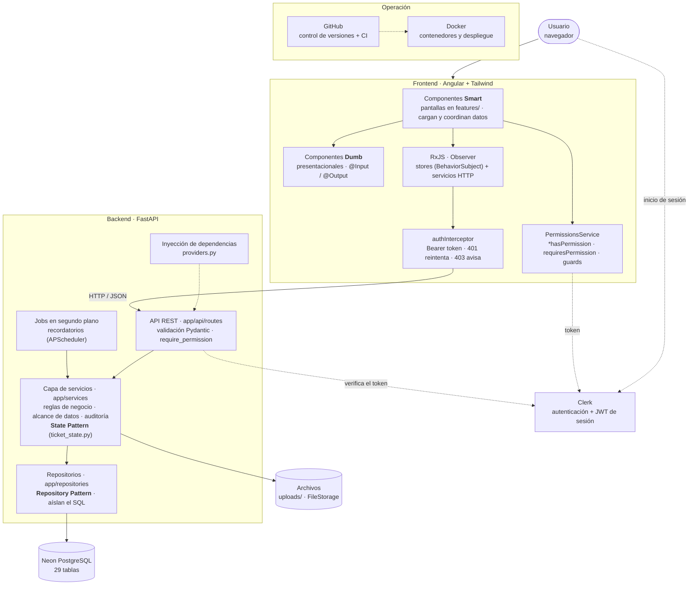
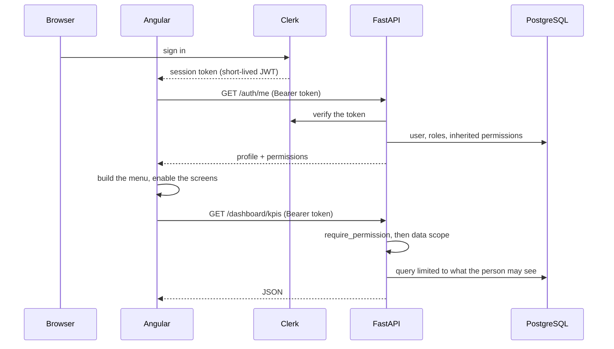
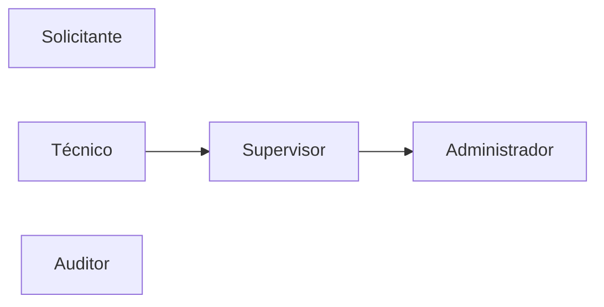

# Architecture

Mantix is a single-page Angular application that talks to a FastAPI backend over REST. The backend owns every rule: authentication is delegated to Clerk, authorization is local, and PostgreSQL (Neon) is the only database.

## Overview



The browser never talks to the database. `DATABASE_URL` is consumed by the backend configuration and Alembic only; it is never part of the frontend. Files go to `uploads/` behind the `FileStorage` port, so the disk can be replaced by an object store without touching business code.

## Design patterns

| # | Patrón | Dónde | Para qué |
| --- | --- | --- | --- |
| 1 | **State** | `backend/app/domain/ticket_state.py` | Cada estado del ticket es una clase con sus transiciones, reglas de entrada y efectos. Sin cadenas de `if/else`. |
| 2 | **Dependency Injection** | `backend/app/api/providers.py` | Cadena `get_db` → repositorio → servicio por petición; todo se puede sustituir en los tests. |
| 3 | **Repository** | `backend/app/repositories/` | Todo el SQL vive aquí; los servicios solo tienen reglas de negocio. |
| 4 | **Observer** | `frontend/src/app/core/*.store.ts` | RxJS (`BehaviorSubject` y observables): la interfaz reacciona a los cambios de estado. |
| 5 | **Smart & Dumb components** | `frontend/src/app/features/` y `shared/` | Los *smart* cargan datos y deciden; los *dumb* solo reciben `@Input` y emiten `@Output`. |
| 6 | **Singleton** | servicios con `providedIn: 'root'` | Una única instancia compartida (permisos, toasts, stores). |

Patterns 1 to 3 are enforced by tests: every status change goes through `TicketState.transition()`, every route receives services through DI, and no service builds a query.

## Frontend

The Angular application is organised by feature, with a few shared building blocks:

```text
core/       services, stores, guards, the auth interceptor, PermissionsService
shared/     reusable components (pagination, toasts, date range, creatable select) and the
            permission directives
layout/     application shell: sidebar, header, notifications bell
features/   dashboard, equipos, tickets, kanban, pending-requests, maintenance-hub,
            inventory, technicians, reports, export, users, roles, admin, settings,
            profile, auth, errors
```

- 61 standalone components, strict TypeScript, lazy-loaded routes (`app.routes.ts`).
- A *smart* component (the screen) asks a store for data and passes it down to *dumb* components. Stores wrap the HTTP services and expose `state$` observables.
- The menu is a list (`core/nav-items.ts`) filtered by permission; each route has a guard that asks for the same permission.
- `authInterceptor` adds the Clerk token to calls to the API only, retries once on `401` with a fresh token and shows a message on `403`.
- The UI hides or disables what the person cannot use; this is a convenience, the backend decides.

## Backend

```text
API             HTTP routes, permission dependencies, Pydantic validation   app/api
Services        business rules, data scope, audit, orchestration            app/services
Domain          ticket state machine                                        app/domain
Repositories    every query: search, sorting, pagination                    app/repositories
Models          SQLAlchemy mappings (29 tables)                             app/models
Core            settings, AuthContext, RBAC resolution, errors, storage     app/core
Jobs            reminders for preventive plans (APScheduler)                app/jobs.py
```

- 117 endpoints. Each one declares the permission it needs (`require_permission("recurso:accion")`) or is explicitly open to any signed-in person; a test fails otherwise.
- Authorization is by permission with role inheritance (`app/core/rbac.py`) and data scope (`app/core/scope.py`): `ver`, `ver_asignados`, `ver_todos`. Repositories receive the scope, so a query cannot forget to apply it.
- Every state-changing operation writes an audit row in the same transaction; denied requests (`403`) are audited too.

## Request flow



## Authorization at a glance



Técnico, Supervisor and Administrador form an inheritance chain (each has everything the previous one has). Solicitante and Auditor stand alone. Administrators can create custom roles with any parent. The matrix is generated in [rbac-matriz.md](rbac-matriz.md).

## Data and secrets

Neon is the database. The application expects `DATABASE_URL` in the environment and uses SQLAlchemy 2 (async) with PostgreSQL; Alembic reads the same setting. `.env` is ignored by Git and `.env.example` only has placeholders. CI secrets are provided with GitHub Secrets. The domain design is in [domain-model.md](domain-model.md).

## Containers and CI

Docker Compose starts PostgreSQL, the backend (migrations on start when `RUN_MIGRATIONS=true`) and the frontend behind nginx. GitHub Actions runs on every pull request:

1. **backend** - ruff (lint and format), mypy, migrations on a fresh PostgreSQL, `alembic check`, tests with a 90 % coverage gate.
2. **frontend** - ESLint, production build, tests.
3. **docker** - builds the images and smoke-tests the stack.

See [deployment.md](deployment.md) for configuration and the release checklist.
