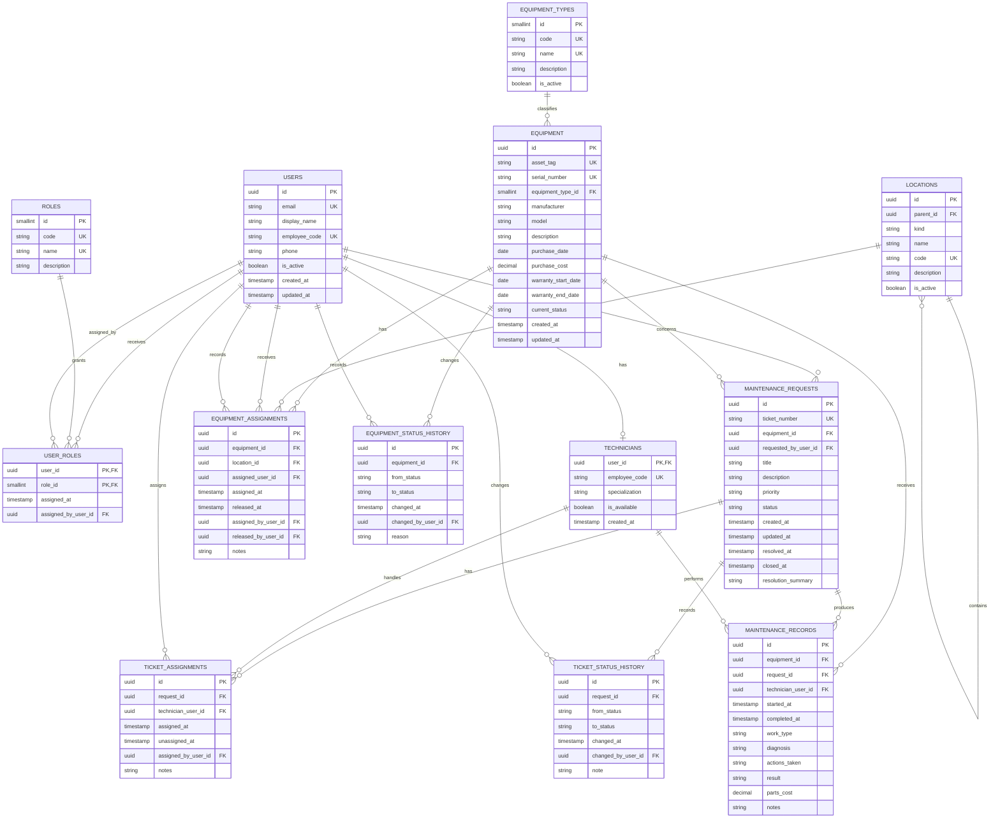

# Database Domain Model

## Executive recommendation

The system should model **people, equipment, work requests, technician assignments, maintenance work, and operational history** as separate but connected concepts. A maintenance request is not the same thing as work performed: a request records a need and its workflow, while a maintenance record records an intervention. Equipment assignment and status changes also require append-only history because the current value alone cannot explain how an asset reached its present state.

The recommended initial model contains the following domain entities:

- `users`, `roles`, and `user_roles` for application users and future multi-role authorization.
- `technicians` as an optional one-to-one profile for users who perform maintenance.
- `equipment_types` for the controlled classification of assets.
- `locations` for hierarchical physical or organizational placement.
- `equipment` for the asset master record.
- `equipment_assignments` for the history of user and location assignments.
- `equipment_status_history` for lifecycle transitions.
- `maintenance_requests` for reported maintenance needs.
- `ticket_assignments` for technician assignment and reassignment history.
- `ticket_status_history` for request workflow history.
- `maintenance_records` for the work actually performed.

This model is normalized to avoid duplicating people, technicians, equipment, and ticket history. It remains compatible with PostgreSQL on Neon, SQLAlchemy, and Alembic. This document is design-only; it does not create SQLAlchemy models, migrations, API endpoints, or application behavior.

## 1. Domain analysis

### 1.1 The system manages an equipment lifecycle

The central domain object is a technology asset that can be acquired, identified, placed, assigned, maintained, and eventually retired. An asset needs a stable internal identity in addition to human-facing identifiers such as an inventory tag and serial number. Its equipment type, technical description, acquisition information, warranty information, and current lifecycle state describe the asset but do not replace its identity.

The model should preserve the asset's changing context. An equipment item can move between locations, be assigned to different users, and pass through several lifecycle states. Therefore, current assignment and current status are convenient projections of historical records rather than the only source of truth.

### 1.2 People have different responsibilities, but they should not be duplicated

A user is a person who can interact with the application. A technician is a user who is qualified to perform maintenance. Treating technicians as a second person table would duplicate names, contact information, and future authentication identity. The recommended design keeps one `users` table and adds an optional `technicians` profile keyed by `user_id`.

Roles are separate from the person record because a user may eventually have more than one responsibility. A many-to-many `user_roles` table is more extensible than a single role column and avoids redesign when a user becomes both a requester and an administrator. The current stage should model this relationship but should not implement authentication or authorization.

### 1.3 Equipment classification should be controlled without becoming polymorphic

Equipment types such as laptop, desktop, monitor, printer, networking device, server, and peripheral are useful for reporting and validation. They justify a reference table because the list is managed data and may grow over time. The model should not create a table for every equipment subtype or use inheritance before subtype-specific behavior is proven necessary.

Manufacturer, model name, model number, serial number, and technical specifications belong on the equipment record at this stage. Manufacturer does not need an independent table yet: the system does not require manufacturer contacts, contracts, or a manufacturer catalog. If those requirements appear later, manufacturer can be extracted without changing the asset's identity.

### 1.4 A location is a hierarchical context, not several unrelated tables

Buildings, floors, offices, laboratories, rooms, and departments are different kinds of placement context. Creating a table for each kind would make equipment placement rigid and introduce unnecessary joins. One `locations` table with a `parent_id` self-reference can represent a building containing a floor, a floor containing a room, or a department serving as an organizational context.

A controlled `location_kind` value preserves the distinction between common location types while the hierarchy preserves containment. A location may have no parent when it is a root. The system should prevent a location from being its own ancestor at the application or database layer when deeper hierarchy validation is introduced.

### 1.5 A request and maintenance work have different meanings

A maintenance request is a report or operational ticket. It captures who requested attention, which equipment is affected, the reported problem, priority, workflow status, and resolution timing. It can exist before any work is performed, and it can be closed without a maintenance record if the request is invalid or resolved through advice.

A maintenance record is an account of actual work. It records the equipment, the optional originating request, the technician, the time spent or work interval, the diagnosis, the action taken, and the result. One request can require multiple interventions. A maintenance record can also exist without a request for preventive or scheduled work. Separating these concepts supports accurate history and avoids treating an opened ticket as proof that work occurred.

### 1.6 History should be specific to the business event

The model uses specific history entities rather than a generic key-value audit table. Equipment assignment history answers where an asset was and who held it. Equipment status history answers how its lifecycle changed. Ticket assignment history answers which technician was responsible over time. Ticket status history answers how a request moved through its workflow. Maintenance records answer what work happened.

This design preserves operational history with typed foreign keys and constraints. It is more queryable and more meaningful than a generic audit table. A future compliance requirement may justify an append-only technical audit log for field-level changes, but that is not necessary to model the current maintenance domain.

## 2. Proposed entities

### 2.1 `users`

**Purpose.** Stores people who can create requests, receive equipment, record changes, or administer the application.

**Important attributes.** Use `id`, `email`, `display_name`, `employee_code` when available, `phone` when available, `is_active`, `created_at`, and `updated_at`. Authentication-specific credentials are intentionally outside this stage.

**Primary key.** A PostgreSQL UUID generated by the application or database.

**Relationships.** A user may create many maintenance requests, may appear in many equipment assignment records, may perform many administrative actions recorded in history, and may have zero or one technician profile. A user may have many roles through `user_roles`.

**Constraints.** `email` should be unique when present and normalized to a consistent case. `employee_code` should be unique when present. An inactive user should not be selected for new assignments by application validation.

### 2.2 `roles`

**Purpose.** Defines application responsibilities for future authorization.

**Important attributes.** Use `id`, `code`, `name`, and `description`.

**Primary key.** A small integer or UUID. A small integer is sufficient for a compact controlled catalog.

**Relationships.** A role belongs to many users through `user_roles`.

**Constraints.** `code` must be unique and stable because application policy will reference it.

### 2.3 `user_roles`

**Purpose.** Resolves the many-to-many relationship between users and roles.

**Important attributes.** Use `user_id`, `role_id`, `assigned_at`, and optionally `assigned_by_user_id` when administrative attribution is required.

**Primary key.** Composite key `(user_id, role_id)`.

**Relationships.** Each row belongs to one user and one role.

**Constraints.** Both foreign keys are required. The composite key prevents duplicate assignments. Foreign keys should cascade on deletion only if the application later permits hard deletion; otherwise, users and roles should be retained or deactivated.

### 2.4 `technicians`

**Purpose.** Stores maintenance-specific information for a user who performs technical work.

**Important attributes.** Use `user_id`, `employee_code` if it differs from the general employee identifier, `specialization`, `is_available`, and `created_at`.

**Primary key.** `user_id`, which is also a foreign key to `users`.

**Relationships.** A technician may receive many ticket assignments and may author many maintenance records.

**Constraints.** `user_id` is unique by being the primary key, which enforces the one-to-zero-or-one profile relationship. A technician must correspond to an active user. Availability is operational state and is not a replacement for ticket assignment history.

### 2.5 `equipment_types`

**Purpose.** Provides a managed classification for equipment.

**Important attributes.** Use `id`, `code`, `name`, `description`, and `is_active`.

**Primary key.** A small integer or UUID.

**Relationships.** One equipment type may classify many equipment items.

**Constraints.** Both `code` and `name` should be unique. Deactivation is preferable to deletion once equipment uses the type.

### 2.6 `locations`

**Purpose.** Represents physical or organizational placement using one hierarchical structure.

**Important attributes.** Use `id`, `parent_id`, `kind`, `name`, `code`, `description`, and `is_active`.

**Primary key.** A UUID.

**Relationships.** A location may contain many child locations. A location may appear in many equipment assignment records.

**Constraints.** `parent_id` references `locations.id` and may be null for a root. A uniqueness rule on `(parent_id, name)` prevents duplicate sibling names; a separate unique `code` is useful when the organization has official location codes. A check or application rule must prevent self-parenting and cycles.

### 2.7 `equipment`

**Purpose.** Stores the stable master record for each technology asset.

**Important attributes.** Use `id`, `asset_tag`, `serial_number`, `equipment_type_id`, `manufacturer`, `model`, `description`, `purchase_date`, `purchase_cost`, `warranty_start_date`, `warranty_end_date`, `current_status`, `created_at`, and `updated_at`.

**Primary key.** A UUID.

**Relationships.** Each equipment item belongs to one equipment type. It may have many assignment records, status history records, maintenance requests, and maintenance records.

**Constraints.** `asset_tag` is required and unique. `serial_number` is nullable because not all peripherals or legacy assets have one; when present, it should be unique. `warranty_end_date` cannot precede `warranty_start_date`, and `purchase_cost` cannot be negative. `current_status` is a PostgreSQL enum in the initial model and must be kept consistent with status history by the service transaction.

### 2.8 `equipment_assignments`

**Purpose.** Preserves the history of where equipment was placed and to whom it was assigned.

**Important attributes.** Use `id`, `equipment_id`, `location_id`, `assigned_user_id`, `assigned_at`, `released_at`, `assigned_by_user_id`, `released_by_user_id`, and `notes`.

**Primary key.** A UUID.

**Relationships.** An equipment item may have many assignments over time. Each assignment may reference one location and zero or one assigned user. A user and location may appear in many assignments.

**Constraints.** At least one of `location_id` or `assigned_user_id` should be present. `released_at` cannot precede `assigned_at`. A partial unique index on `equipment_id` for rows where `released_at IS NULL` enforces one current assignment at a time. If the organization later needs simultaneous custody and placement records, those concepts can be split deliberately rather than weakening this constraint.

### 2.9 `equipment_status_history`

**Purpose.** Preserves lifecycle transitions such as active, in repair, in storage, lost, retired, or disposed.

**Important attributes.** Use `id`, `equipment_id`, `from_status`, `to_status`, `changed_at`, `changed_by_user_id`, and `reason`.

**Primary key.** A UUID.

**Relationships.** Each row belongs to one equipment item and is attributed to one user when the change is user-driven.

**Constraints.** `to_status` is required. `from_status` may be null for the initial state. History is append-only from the application perspective. The equipment current status and the latest history event should be updated in one transaction.

### 2.10 `maintenance_requests`

**Purpose.** Represents a reported maintenance need and its workflow.

**Important attributes.** Use `id`, `ticket_number`, `equipment_id`, `requested_by_user_id`, `title`, `description`, `priority`, `status`, `created_at`, `updated_at`, `resolved_at`, `closed_at`, and `resolution_summary`.

**Primary key.** A UUID. `ticket_number` is a separate human-readable unique identifier.

**Relationships.** A user may create many requests. Each request concerns one equipment item. A request may have many technician assignments, status history entries, and maintenance records.

**Constraints.** `ticket_number` must be unique. `title`, `description`, `equipment_id`, and `requested_by_user_id` are required. Resolution timestamps should be present only when the status reaches a resolved or closed state, enforced by service validation and optionally by database checks. `closed_at` cannot precede `resolved_at`.

### 2.11 `ticket_assignments`

**Purpose.** Preserves assignment and reassignment of a maintenance request to technicians.

**Important attributes.** Use `id`, `request_id`, `technician_user_id`, `assigned_at`, `unassigned_at`, `assigned_by_user_id`, and `notes`.

**Primary key.** A UUID.

**Relationships.** One request may have many assignment periods. One technician may handle many requests. The assigning user may be different from the technician.

**Constraints.** `technician_user_id` must reference a row in `technicians.user_id`. `unassigned_at` cannot precede `assigned_at`. A partial unique index on `request_id` where `unassigned_at IS NULL` enforces one current responsible technician. The full history remains available after reassignment.

### 2.12 `ticket_status_history`

**Purpose.** Preserves every meaningful workflow transition for a request.

**Important attributes.** Use `id`, `request_id`, `from_status`, `to_status`, `changed_at`, `changed_by_user_id`, and `note`.

**Primary key.** A UUID.

**Relationships.** Each entry belongs to one request and is attributed to one user when available.

**Constraints.** `to_status` is required. `from_status` may be null for the initial status. Entries should be append-only. A database check can reject a transition from a status to itself if no explicit reason exists.

### 2.13 `maintenance_records`

**Purpose.** Records the actual technical work performed on equipment.

**Important attributes.** Use `id`, `equipment_id`, `request_id`, `technician_user_id`, `started_at`, `completed_at`, `work_type`, `diagnosis`, `actions_taken`, `result`, `parts_cost`, and `notes`.

**Primary key.** A UUID.

**Relationships.** Each record belongs to one equipment item and one technician. It may refer to one maintenance request. One request can have many records, and an equipment item can have many records across its lifetime.

**Constraints.** `equipment_id`, `technician_user_id`, `started_at`, and `result` are required. `request_id` is nullable to support preventive or unscheduled work. `completed_at` cannot precede `started_at`. Costs cannot be negative. The referenced technician must exist in `technicians`.

## 3. Relationship model and cardinalities

The main relationships are:

- A user may create zero or many maintenance requests; each request has exactly one requesting user.
- A user may have zero or one technician profile; each technician profile belongs to exactly one user.
- A user may have many roles, and a role may belong to many users through `user_roles`.
- An equipment type may classify many equipment items; each equipment item has exactly one equipment type.
- A location may contain zero or many child locations; each child location has zero or one parent.
- An equipment item may have zero or many assignment records, with at most one open assignment.
- An equipment item may have zero or many status history records.
- A user may appear in many assignment records, while each assignment has at most one assigned user.
- An equipment item may have zero or many maintenance requests; each request concerns exactly one equipment item.
- A maintenance request may have zero or many ticket assignments, with at most one open assignment.
- A technician may appear in many ticket assignments and many maintenance records.
- A maintenance request may have zero or many status history records.
- A maintenance request may produce zero or many maintenance records.
- An equipment item may have zero or many maintenance records; each maintenance record concerns exactly one equipment item.

## 4. PostgreSQL-compatible enum choices

The initial model should use PostgreSQL enums for values that represent a small, controlled workflow or lifecycle vocabulary:

- `equipment_status`: `active`, `in_repair`, `in_storage`, `lost`, `retired`, `disposed`.
- `maintenance_priority`: `low`, `medium`, `high`, `critical`.
- `maintenance_request_status`: `submitted`, `triaged`, `assigned`, `in_progress`, `waiting`, `resolved`, `closed`, `cancelled`.
- `location_kind`: `building`, `floor`, `office`, `laboratory`, `room`, `department`, `other`.
- `maintenance_work_type`: `corrective`, `preventive`, `inspection`, `installation`, `recovery`, `other`.

These values are part of application workflow and benefit from database-level validation. `equipment_types`, `roles`, and other values managed by administrators should be lookup tables because they may be renamed, deactivated, or expanded without a migration. If workflow values become organization-configurable, they can later be migrated from enums to reference tables.

## 5. Important design decisions

### 5.1 Identifier strategy

> **Implementation note.** The implemented schema uses **integer identity primary keys** (`BIGINT GENERATED BY DEFAULT AS IDENTITY`) instead of the UUIDs originally proposed in this document, and every `uuid`/`smallint` key in the ER diagram below should be read as `bigint`. Integer keys are simpler to join and index, and the exposure risk of sequential IDs is handled by authorization checks (visibility rules in the service layer) rather than by obscurity. Human-readable unique identifiers are used where users need them: `asset_tag` and `ticket_number` (`TCK-<year>-<sequence>`).

### 5.2 User and technician relationship

Technicians should be users with an additional profile, not an independent person table. This avoids duplicate identity data and supports a person becoming a requester, technician, supervisor, or administrator without migration. The trade-off is that application validation must ensure only technician profiles can receive maintenance work.

### 5.3 Reference tables versus enums

Use lookup tables when administrators may manage the values or when a value needs descriptive metadata. Use enums for small, stable workflow vocabularies. PostgreSQL enums provide strong validation but require an operational migration when values change, so they should not be used for equipment types, locations, or roles.

### 5.4 Normalization

The design stores each fact once. Equipment type is not repeated as text on every ticket. User contact information is not copied into technician or assignment records. Assignment history is not embedded as a JSON array on equipment. Maintenance work refers to equipment and technician through foreign keys. This supports consistent updates, reliable joins, and report queries.

### 5.5 History strategy

Specific history tables are preferred over a generic audit table because each history concept has different integrity rules and reporting needs. Status history contains transitions. Assignment history contains time intervals and responsibility. Maintenance records contain work details. The trade-off is more tables and transaction logic, but the result is easier to validate and query. A generic technical audit log remains a future option for compliance-driven field-level auditing.

### 5.6 Equipment lifecycle

`equipment.current_status` is a convenient current projection. `equipment_status_history` is the durable explanation of lifecycle changes. Both should be changed in one transaction. This allows fast inventory queries while retaining the history required for failure and retirement reports.

### 5.7 Ticket lifecycle

A request has a current `status` for operational filtering and a status history for traceability. Technician assignment is separate from status because a ticket can be assigned, reassigned, or temporarily unassigned without every assignment change being a status transition.

### 5.8 Maintenance representation

Maintenance work is separate from the request because not every request produces work and one request can require several interventions. This separation also supports preventive maintenance without forcing the system to create artificial tickets.

### 5.9 Location representation

A single self-referencing location table is more flexible than separate building, floor, room, and department tables. The `kind` field preserves semantic classification while `parent_id` represents containment. The trade-off is that hierarchical consistency requires application validation or PostgreSQL-specific recursive checks.

### 5.10 Report strategy

Reports should be generated by application queries, database views, or materialized views only when measurement shows that repeated aggregation is expensive. The base tables already preserve the facts needed for inventory, workload, maintenance activity, resolution time, and trends. A `reports` table would store output rather than domain facts and would introduce synchronization problems.

## 6. Constraints and indexes

### 6.1 Uniqueness constraints

- `users.email` should be unique when not null.
- `users.employee_code` should be unique when not null.
- `roles.code` and `roles.name` should be unique.
- `equipment_types.code` and `equipment_types.name` should be unique.
- `locations.code` should be unique when provided; `(parent_id, name)` should be unique for sibling locations.
- `equipment.asset_tag` is required and unique.
- `equipment.serial_number` should be unique when provided.
- `maintenance_requests.ticket_number` is required and unique.
- `user_roles(user_id, role_id)` is unique through its composite primary key.

### 6.2 Foreign keys

All relationships described above should use explicit foreign keys. In particular, equipment, request, assignment, history, and maintenance records should not store free-text references to users, technicians, locations, or equipment types. Foreign keys should generally use `RESTRICT` or `NO ACTION` behavior for historical domain records so that accidental deletion cannot destroy traceability. Deactivation and archival are preferable to hard deletion.

### 6.3 Check constraints

At minimum, implement these checks:

- Warranty end is on or after warranty start.
- Purchase cost and parts cost are non-negative.
- Release time is on or after assignment time.
- Ticket close time is on or after resolution time.
- Maintenance completion time is on or after start time.
- A current equipment assignment references a location, a user, or both.
- A status history event has a target status.
- A location is not its own parent.

Cross-row rules such as one open assignment per equipment and one open technician assignment per request are best enforced with partial unique indexes.

### 6.4 Recommended indexes

- `equipment(equipment_type_id)` for inventory by category.
- `equipment(current_status)` for active, repair, and retired inventory views.
- `equipment(serial_number)` for lookup by serial number.
- `equipment_assignments(equipment_id, assigned_at DESC)` for asset history.
- `equipment_assignments(location_id, released_at)` for current inventory by location.
- `equipment_assignments(assigned_user_id, released_at)` for current custody by user.
- `equipment_status_history(equipment_id, changed_at DESC)` for lifecycle history.
- `maintenance_requests(status, priority, created_at)` for queue filtering.
- `maintenance_requests(equipment_id, created_at DESC)` for asset ticket history.
- `maintenance_requests(requested_by_user_id, created_at DESC)` for requester history.
- `ticket_assignments(technician_user_id, unassigned_at)` for technician workload.
- `ticket_assignments(request_id, assigned_at DESC)` for reassignment history.
- `ticket_status_history(request_id, changed_at DESC)` for workflow history.
- `maintenance_records(equipment_id, started_at DESC)` for maintenance history.
- `maintenance_records(technician_user_id, started_at DESC)` for technician activity.
- `maintenance_records(request_id)` for work associated with a ticket.

Partial unique indexes should enforce one open `equipment_assignments` row per equipment and one open `ticket_assignments` row per request.

## 7. Report feasibility

| Report | Required data | Recommended implementation |
|---|---|---|
| Equipment inventory | `equipment`, `equipment_types`, `equipment_assignments`, `locations` | Query joining the current assignment and active equipment state. |
| Maintenance history | `equipment`, `maintenance_records`, `technicians`, `maintenance_requests` | Query ordered by work start time, optionally filtered by asset or date. |
| Tickets by status | `maintenance_requests.status` | Grouped query; a view is optional if used frequently. |
| Tickets by priority | `maintenance_requests.priority` | Grouped query with date and status filters. |
| Technician workload | `ticket_assignments`, `maintenance_requests`, `technicians` | Query current open assignments and historical throughput. |
| Maintenance activity | `maintenance_records`, `equipment`, `technicians` | Group by technician, work type, equipment type, or period. |
| Equipment failures | `maintenance_requests`, `maintenance_records`, `equipment_status_history` | Define failure criteria in the service/query layer; do not add a failure table prematurely. |
| Maintenance trends | `maintenance_records`, `maintenance_requests` | Date aggregation by week or month; a materialized view may help at scale. |
| Resolution times | `maintenance_requests.created_at`, `resolved_at`, `closed_at` | Calculate durations in a query or reporting view. |
| Equipment by location | Current `equipment_assignments` joined to `locations` | Recursive query or view when reporting a complete location subtree. |

No report entity is necessary. Database views are appropriate for stable, frequently reused projections such as current inventory or open workload. Materialized views should be introduced only after query performance and refresh requirements are known.

## 8. Future extensibility

The model can accommodate preventive maintenance plans by adding schedules and generated work requests without changing the existing equipment, request, or maintenance concepts. It can support spare parts through separate inventory and consumption entities if parts management becomes a real requirement. It can support multiple technicians on one intervention through a `maintenance_record_technicians` join table if the current single-technician record proves insufficient.

The model can also support attachments by adding a file metadata entity linked to requests, equipment, or maintenance records. Notifications can reference domain events without changing the source tables. Authentication can add credential and session tables behind the existing `users` identity. More detailed equipment specifications can be introduced as subtype tables only when reporting and validation requirements justify them; the initial model deliberately avoids premature polymorphism.

## 9. Final schema summary

The recommended normalized model consists of thirteen tables:

1. `users`
2. `roles`
3. `user_roles`
4. `technicians`
5. `equipment_types`
6. `locations`
7. `equipment`
8. `equipment_assignments`
9. `equipment_status_history`
10. `maintenance_requests`
11. `ticket_assignments`
12. `ticket_status_history`
13. `maintenance_records`

The model uses UUID domain identifiers, managed lookup tables for extensible catalogs, PostgreSQL enums for stable workflows, explicit foreign keys, partial unique indexes for current assignments, and specific history tables for operational traceability.

## 10. Mermaid ER diagram

The diagram below contains only the proposed entities and relationships. Enum values are shown as attribute types so the diagram remains valid Mermaid `erDiagram` syntax and can be rendered by GitHub, Mermaid Live Editor, or a VS Code Mermaid extension.

## References

[1]: https://www.postgresql.org/docs/current/ddl-constraints.html "PostgreSQL documentation: Constraints"
[2]: https://www.postgresql.org/docs/current/indexes-partial.html "PostgreSQL documentation: Partial Indexes"
[3]: https://docs.sqlalchemy.org/en/20/orm/basic_relationships.html "SQLAlchemy documentation: Relationships"
[4]: https://docs.sqlalchemy.org/en/20/core/type_basics.html "SQLAlchemy documentation: Column and Data Types"

## 11. Additions after the initial design

- `priorities`: managed catalog (`code`, `name`, `level`, `sla_hours`, `is_active`). `maintenance_requests.priority` is a foreign key to `priorities.code`, replacing the former CHECK constraint.
- `maintenance_schedules`: recurring preventive-maintenance plans per equipment (`interval_days`, `next_due_at`, `remind_days_before`), used by the scheduled reminder job.
- `permissions` / `role_permissions` / `audit_logs` / `attachments` / `notifications`: authorization catalog, field-level audit trail, file metadata and in-app notifications, implemented as described in `docs/architecture.md`.
- Added indexes: `maintenance_requests(status, priority, created_at)`, `maintenance_requests(equipment_id, created_at)`, `audit_logs(entity_type, entity_id)`, `audit_logs(created_at)`, `maintenance_schedules(is_active, next_due_at)`.
